# 👋 Hi there, I'm kongzhuww (空竹)

<strong>AI Systems & MLX · Full-Stack & Tooling · Embedded Engineering · Open Source Enthusiast</strong>

  <strong>English</strong> · <a href="README_zh.md">简体中文</a>

  
  
  
  

---

### tab-project is now on Microsoft Edge Add-ons

A milestone for my open-source work: my browser new-tab workspace is now available on the Microsoft Edge Add-ons store.

Favorite sites, bookmarks, unified search, and optional GitHub, Todoist, Bilibili, and music modules in one theme-adaptive workspace.

[Source code](https://github.com/kongzhuww/tab-project) · [Report an issue](https://github.com/kongzhuww/tab-project/issues) · [Release history](https://github.com/kongzhuww/tab-project/releases)

---

### 💡 About Me

I am a software engineer and hardware enthusiast passionate about bridging **on-device artificial intelligence**, **developer workflows**, and **responsive desktop/browser productivity systems**. 

- 🧠 **On-Device & Multimodal AI**: Porting and optimizing state-of-the-art vision-language models natively for Apple Silicon (MLX), exploring missing-target rejection and boundary reliability.
- ⚡ **Coding Agent Ecosystem**: Creating intelligent plugins, TUI managers, and automation skills for cutting-edge coding agents like [Pi](https://github.com/earendil-works/pi).
- 🖥️ **Personal Productivity Workspaces**: Designing clean, theme-adaptive browser new-tab workspaces and desktop widgets that streamline fragmented daily tasks.
- 🛠️ **Embedded & Robotics Tooling**: Building AI-assisted PID tuners, robotics simulations (ROS / ROS 2), and microcontroller developer tools (TI MSPM0, K230).

---

### 🚀 Featured Open Source Projects

#### 🧠 On-Device AI & Multimodal Research
- **[mlx-grounding-pi](https://github.com/kongzhuww/mlx-grounding-pi)**: Experimental native Apple MLX port of GroundingPI for local point/bbox visual grounding on Apple Silicon (tested on M4).
- **[grounding-pi-rejection-lab](https://github.com/kongzhuww/grounding-pi-rejection-lab)**: Research lab exploring missing-target rejection datasets, metrics, and evaluation pipelines to prevent hallucinated detections.

#### ⚡ Coding Agent Ecosystem (Pi)
- **[pi-command-aliases](https://github.com/kongzhuww/pi-command-aliases)**: Interactive split-pane visual TUI manager and argument-forwarding suite for Pi extension commands. Published on npm (`pi install npm:pi-command-aliases`) with 600+ monthly downloads.
- **[pi-remote-mesh](https://github.com/kongzhuww/pi-remote-mesh)**: Multi-device remote SSH execution mesh and on-demand tool exposure for Pi Coding Agent. Published on npm (`npm:pi-remote-mesh`).
- **[pi-desktop-toast](https://github.com/kongzhuww/pi-desktop-toast)**: Zero-dependency native OS desktop notifications (macOS, Windows WinRT, Linux notify-send) for long-running agent tasks and prompts. Published on npm (`npm:pi-desktop-toast`).
- **[pi-smart-quota](https://github.com/kongzhuww/pi-smart-quota)**: Smart adaptive quota monitor for OpenAI Codex and Google Antigravity (AGY) with real-time statusline integration. Published on npm (`npm:pi-smart-quota`).

#### 🖥️ Workspaces & Productivity
- **[tab-project](https://github.com/kongzhuww/tab-project)**: All-in-one browser new-tab workspace (Vue 3 + TypeScript + Chromium MV3) featuring bookmark kanban, custom folders, Bilibili radio, and GitHub Topic sync.
- **[tab-project-website (logicweaver.me)](https://logicweaver.me)**: Static showcase and privacy review site built on Next.js 16 and Cloudflare Workers for the tab-project ecosystem.
- **[BrimDeck](https://github.com/kongzhuww/BrimDeck)**: Windows 11 Dynamic Island widget for monitoring AI coding tool quotas, system resources, and media controls.
- **[CLI-Manager](https://github.com/kongzhuww/CLI-Manager)**: Multi-project AI CLI workspace supporting local terminals, persistent SSH hosts, and mobile-assisted terminal workflows.

#### 🛠️ Embedded Systems & Hardware Tooling
- **[mspm0g-pid-tuner](https://github.com/kongzhuww/mspm0g-pid-tuner)**: AI-assisted real-time PID tuning interface and monitoring pipeline for Texas Instruments MSPM0G3507 microcontrollers.
- **[lushan-k230-skill](https://github.com/kongzhuww/lushan-k230-skill)**: Tailored Claude Code skill for the Lushan Pi K230 / K230D CanMV MicroPython edge AI board.

---

### 🛠️ Tech Stack & Toolbox

| Domain | Technologies & Tools |
| :--- | :--- |
| **Languages** | `Python` `TypeScript` `JavaScript` `C / C++` `Rust` `HTML5` `CSS3` `PowerShell` `Bash` |
| **AI & ML** | `Apple MLX` `PyTorch` `Hugging Face` `OpenCV` `Antigravity / Gemini` `Vision-Language Models` |
| **Frontend & Web** | `Vue 3` `React` `Next.js` `Vite` `Tailwind CSS` `Chromium MV3 Extensions` |
| **Robotics & IoT** | `ROS / ROS 2` `Gazebo` `TI MSPM0` `Kendryte K230` `MicroPython` `FreeRTOS` |
| **DevOps & Cloud** | `Node.js` `Cloudflare Workers` `Git` `Docker` `GitHub Actions` `uv` |

---

### 📊 GitHub Stats

  
  

  

---

  Designed with ❤️ by <a href="https://github.com/kongzhuww">kongzhuww</a> · Always exploring, always building.

