# 👋 你好，我是 kongzhuww (空竹)

<strong>AI 系统与端侧 MLX · 全栈工具链 · 嵌入式工程 · 开源爱好者</strong>

  <strong>简体中文</strong> · <a href="README_en.md">English</a>

  
  
  
  

---

### tab-project 已上架 Edge 商店

从个人开发的新标签页工作台，到正式上架 Microsoft Edge 加载项商店，这是我开源项目的一个里程碑。

常用网站、书签、聚合搜索，以及按需启用的 GitHub、Todoist、B站与音乐组件，都集中在一个自适应主题的工作台中。

[项目源码](https://github.com/kongzhuww/tab-project) · [反馈问题](https://github.com/kongzhuww/tab-project/issues) · [更新记录](https://github.com/kongzhuww/tab-project/releases)

---

### 💡 关于我

热衷于将**端侧人工智能**、**开发者自动化工作流**与**高响应性的桌面与浏览器生产力系统**融为一体。

- 🧠 **端侧 AI 与多模态视觉研究**：专注 Apple Silicon (MLX) 原生模型移植、端侧视觉定位及缺失目标（Missing Target）拒识边界评测。
- ⚡ **编码智能体（Coding Agent）生态**：为 [Pi](https://github.com/earendil-works/pi) 等前沿 Coding Agent 打造交互式别名管理套件、TUI 面板与自动化 Skill。
- 🖥️ **个人生产力与工作空间**：构建清爽、自适应主题的浏览器新标签页工作台与桌面效率组件，聚合分散的高频工作流。
- 🛠️ **嵌入式与硬件智能化工具**：开发 AI 辅助实时 PID 调优器、ROS/Gazebo 机器人仿真工作空间及微控制器开发工具（TI MSPM0、K230）。

---

### 🚀 精选开源项目矩阵

#### 🧠 端侧 AI 与多模态视觉定位
- **[mlx-grounding-pi](https://github.com/kongzhuww/mlx-grounding-pi)**：GroundingPI 的 Apple Silicon (MLX) 原生移植版，在 Mac M4 上实现纯本地「图像+指令 $\rightarrow$ 点/框」视觉定位。
- **[grounding-pi-rejection-lab](https://github.com/kongzhuww/grounding-pi-rejection-lab)**：针对 GroundingPI 目标缺失场景建立的独立研究实验室，提供数据生成、评估指标与评测基线管线。

#### ⚡ 智能体扩展与生态工具 (Pi)
- **[pi-tools](https://github.com/kongzhuww/pi-tools)**：专为 [Pi Coding Agent](https://github.com/earendil-works/pi-coding-agent) 打造的官方一体化单体大仓库（Monorepo）扩展套件：
  - **`pi-command-aliases`**：交互式分栏 TUI 命令别名管理器与参数透明透传套件（npm 月下载量 600+）。
  - **`pi-remote-mesh`**：多端远程 SSH 执行网格与按需工具调度套件，一行配置管全家。
  - **`pi-desktop-toast`**：极轻量零依赖的跨平台系统原生桌面通知扩展（macOS / WinRT / Linux）。
  - **`pi-smart-quota`**：专为 OpenAI Codex 与 Google Antigravity (AGY) 设计的智能额度监控插件。

#### 🖥️ 生产力与工作台
- **[tab-project](https://github.com/kongzhuww/tab-project)**：一站式浏览器新标签页个人工作台（Vue 3 + TypeScript + Chromium MV3），集成常用网站大文件夹、书签看板、多引擎聚合、B站电台与 GitHub Topic 看板。
- **[tab-project-website (logicweaver.me)](https://logicweaver.me)**：基于 Next.js 16 与 Cloudflare Workers 部署的静态展示与隐私政策官网。
- **[BrimDeck](https://github.com/kongzhuww/BrimDeck)**：专为 Windows 11 打造的桌面灵动岛，实时跟踪 AI 编程工具配额、系统资源状态与媒体控制。
- **[CLI-Manager](https://github.com/kongzhuww/CLI-Manager)**：支持本地终端、持久化 SSH 主机与移动端协同的多项目 AI CLI 工作台。

#### 🛠️ 嵌入式与硬件工具
- **[mspm0g-pid-tuner](https://github.com/kongzhuww/mspm0g-pid-tuner)**：面向德州仪器 MSPM0G3507 单片机的 AI 辅助实时 PID 调参工具与数据管道。
- **[lushan-k230-skill](https://github.com/kongzhuww/lushan-k230-skill)**：为 Claude Code 定制的立创·庐山派 K230/K230D CanMV MicroPython 端侧 AI 开发助手。

---

### 🛠️ 技能栈与工具箱

| 领域 | 核心技术与工具 |
| :--- | :--- |
| **编程语言** | `Python` `TypeScript` `JavaScript` `C / C++` `Rust` `HTML5` `CSS3` `PowerShell` `Bash` |
| **人工智能** | `Apple MLX` `PyTorch` `Hugging Face` `OpenCV` `Antigravity / Gemini` `Vision-Language Models` |
| **全栈与前端** | `Vue 3` `React` `Next.js` `Vite` `Tailwind CSS` `Chromium MV3 Extensions` |
| **机器人与嵌入式** | `ROS / ROS 2` `Gazebo` `TI MSPM0` `Kendryte K230` `MicroPython` `FreeRTOS` |
| **平台与工程化** | `Node.js` `Cloudflare Workers` `Git` `Docker` `GitHub Actions` `uv` |

---

### 📊 GitHub 动态统计

  
  

  

---

  Designed with ❤️ by <a href="https://github.com/kongzhuww">kongzhuww</a> · 持续探索，持续构建。

